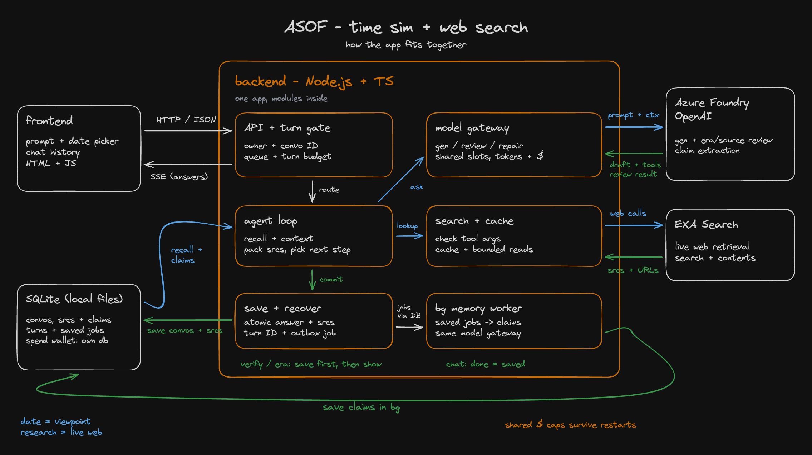

# Design

**asof answers a question twice: when you first ask it, and when you return to ask whether it is still true.** It has one external tool, web search. Its memory preserves what was said, when it was said, and the evidence behind it.

## How it works

For “Last Tuesday I asked about Postgres hosting. Has pricing changed?”, the agent first resolves Tuesday in the user's timezone and finds the relevant conversation. It uses the earlier answer to identify what needs checking, then researches current sources through Exa and explains what changed, what stayed the same, and what it could not establish. Missing history is a gap to explain, not permission to invent a previous discussion.

A TypeScript/Node server owns the request from admission to persistence. Code handles dates, owner boundaries, context limits and tool validation. The model handles language, focused search proposals and synthesis. Exa Search and Contents share the single `web_search` interface: discover pages or read a known source without adding another agent tool. Independent lookups overlap; repeated passages are deduplicated before entering a bounded evidence window.

Current-chat follow-ups use durable conversation order, even after changing the viewpoint. Other conversations enter context only for explicit personal-memory requests. Earlier claims and retrieved passages remain untrusted reference material. Answers cite numbered passages, and the ledger stores the exact cited text and its hash alongside the answer.

## Fast when possible, careful when needed

Conversation and supplied-text transformations take a direct model path without a mandatory planner call. Explicit factual verification uses fresh applicable evidence and a separate claim-support review. Factual era simulations also check temporal perspective. A known rejection survives a malformed correction or reviewer outage; uncertain results remain visibly qualified. Citation validity checks references, while model review assesses support. Neither proves truth.

Ordinary text streams provisionally over SSE. Verification and factual simulation commit before publishing final prose. Durable turn IDs and idempotency keys recover saved answers after a lost connection without generating duplicates. Summaries and claims are extracted through a durable background queue, with lower priority than foreground responses. Shared request, token and deadline limits keep research and background work from overwhelming the model gateway.

## Why this architecture

One modular service and local SQLite keep transactions, recovery and deployment understandable. Full-text recall avoids an extra retrieval service; explicit model, search and clock interfaces make failures reproducible in tests. The tradeoff is a single-host design with lexical recall and external-provider latency. Hosted owner isolation is implemented, but multiple application instances would need shared storage and coordination.

I rejected mandatory planning agents and provider federation because they add calls and failure paths before demonstrating a quality gain. I deferred embeddings and distributed services until recall misses or measured load justify them. Snapshot-only retrieval was too restrictive for arbitrary historical questions: era simulation uses live retrospective sources to reconstruct a viewpoint, while acknowledging that hindsight can still slip through.

## With another week

I would concentrate on evidence quality: human-label held-out follow-up questions, assess claim-to-passage support and calibrated uncertainty, and compare retrieval strategies on identical inputs. I would also repeat five-user latency measurements on the deployment target, including queue time, review overhead and interrupted-stream recovery. Automated tests and frozen fixtures establish software behavior; independent answer quality and same-or-better hosted latency still need measurement.
