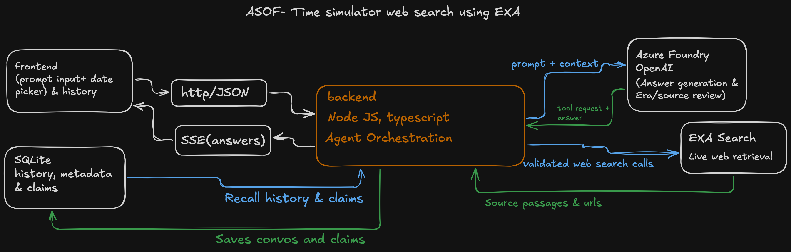

# Design

**asof is a web research assistant with a memory of what it said and when.** The useful follow-up is “is that still true?” Answering it needs dated claims and their sources, not just a transcript.

## How it works

A browser client sends the question, timezone and date to a TypeScript/Node.js server; SSE carries progress and answers. Code resolves calendar references, pins request time and recalls conversations by date and SQLite full-text search. Bounded history and memory accompany the untouched question; retrieved text remains untrusted.

Azure-hosted GPT plans retrieval through Exa, the sole search/source provider. An underspecified request can pause for one optional multiple-choice question before research. A real choice, free-text detail or skip resumes the saved request. This UI control clarifies preferences; it does not retrieve facts.

Validated Exa Search/Contents calls run concurrently within fixed budgets: three search rounds, twelve lookups and a 32,000-character evidence window. Recheck searches bypass the result cache. Answers cite numbered passages; the Ledger saves the answer, exact cited text, hashes and execution context together. Present-day conversations receive background summaries and linked claims; simulated answers remain conversation records rather than verified claims.

**Time travel is an era simulation.** Live sources, including modern histories, establish events; the selected date controls the answer’s perspective. A factual historical draft receives a separate era/source review and, when needed, one revision before display. This reconstructs a viewpoint, not what the web contained then. Citation validation checks references; model review cannot guarantee truth or eliminate hindsight.

## Why this shape

A modular monolith keeps orchestration and persistence inspectable. Native SQLite provides transactions and recall without another service; an injected clock makes temporal behavior reproducible. Code handles dates and memory, while the model handles language. No mandatory planner call precedes every answer, and lookups overlap. Explicit interfaces make the engine testable without live APIs. The tradeoff is a single-process, single-user prototype with lexical recall and an in-memory extraction queue.

## Considered and rejected

- **Snapshot-only retrieval and a curated temporal graph:** coverage, access limits and ingestion requirements made arbitrary dates brittle. Live retrospective research supports the intended simulation; archival proof is a different product.
- **A vector database or distributed services:** added infrastructure before recall volume justified it. SQLite is sufficient for this prototype.
- **Mandatory planning agents or multiple search providers:** extra latency, cost and failure paths without measured gains. Exa stays the sole retrieval boundary.

## With another week

I would prioritize correctness and recovery over more features: preserve negative review findings through reviewer failures, require evidence for explicit factual verification, and distinguish supported answers from uncertainty. Next, add durable turn IDs, restart-safe extraction and conversation ordering independent of simulated dates; require owner isolation before shared hosting. Finally, expand held-out factual, historical and clarification cases, measure citation support and hindsight leakage with human review, and track p50/p95 latency and cost. Existing scripted tests validate behavior, not a claim of perfect accuracy.
