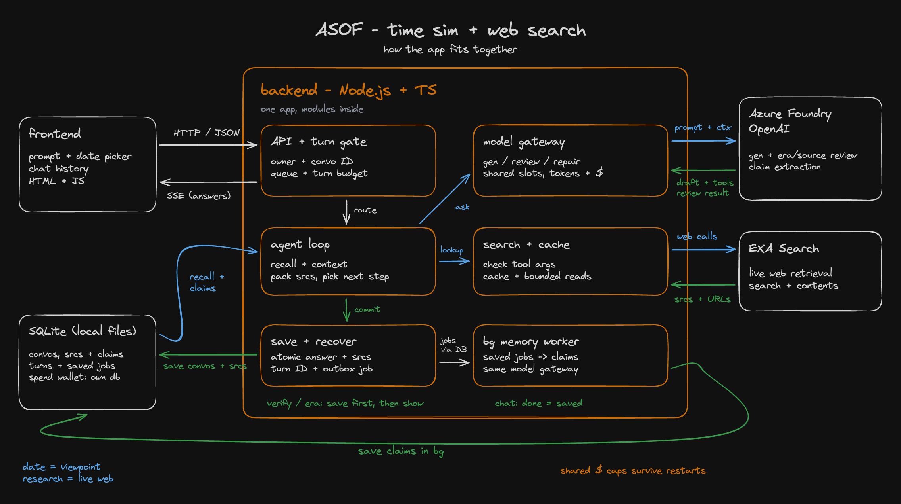

# asof

A chat agent with one tool, **web search**, and a memory of what it told you and when.

asof connects the current conversation to fresh web research. Ask a question, come back later, and check whether the answer still holds. Follow-ups stay anchored to the current chat, even when the viewpoint changes. Other conversations are recalled only when you explicitly ask for personal memory; their claims are reference records rather than verified evidence.

**Live demo:** [Open asof](https://asof-f2gl2x6yvy64q.centralindia.cloudapp.azure.com/). No sign-in required. Each browser has its own chat history; return in the same browser to revisit earlier answers.

[Design decisions](DESIGN.md) · [Architecture](docs/architecture/README.md) · [Evaluation](docs/evaluation.md)

## What you can ask

- “On Monday we shortlisted 5 CRM tools for a 20-person sales team. Have any of them shipped major updates since?”
- “What did I ask you on 3 November? Is your answer still correct today?”
- “Last Tuesday I asked you about Postgres hosting. Have any features changed since then?”

These questions need an existing conversation history. A fresh installation starts with an empty memory; the agent should identify that gap rather than invent an earlier discussion. Ambiguous dates remain separate, and an empty requested date does not substitute a nearby or topic-matched conversation.

The date picker also supports **era simulation**: answer from a selected historical perspective while researching the live web. Modern sources can establish historical events, but later outcomes should not be presented as knowledge available in that era. This is a reconstructed perspective, not a frozen historical internet.

## Architecture



The backend is one Node.js application with separate modules for orchestration, retrieval, memory and execution limits.

1. **Accept the request.** The API validates the message, identifies its owner and conversation, pins the selected viewpoint, and admits the turn within queue and execution limits.
2. **Prepare context.** Durable turn order preserves the current chat independently of the selected viewpoint. Follow-ups reference that chat; cross-conversation recall runs only for explicit personal-memory requests. Earlier answers and source passages are treated as reference material, not instructions or automatically verified facts.
3. **Research.** The model decides what to search through the single `web_search` tool. Exa Search discovers pages; Exa Contents reads selected sources through the same tool. Validation, caching, concurrency limits and bounded evidence packing control the work.
4. **Answer and review.** The model synthesizes numbered source passages. Explicit factual verification and factual era simulation receive evidence/perspective review; unresolved facts remain qualified. Ordinary responses can stream provisionally.
5. **Save and recover.** Accepted answers and cited evidence commit together in SQLite. Durable turn IDs support recovery after an interrupted connection. A completion event means the answer was saved; verification and factual simulation save before publishing their final prose.
6. **Enrich memory.** A background worker processes durable jobs to extract summaries, topics and claims. It uses the same model gateway, with lower priority than foreground answers.

Model requests share concurrency and token limits. Source passages, citation references and review outcomes make answers inspectable; model review still does not guarantee factual correctness.

See the [backend capabilities](docs/architecture/README.md) and [conversation/memory boundaries](docs/architecture/context-memory-boundaries.md) for the detailed contracts.

## Stack and models

| Component | Implementation |
| --- | --- |
| Runtime | Node.js and TypeScript, executed with `tsx` |
| Frontend | HTML, CSS and browser JavaScript |
| Transport | HTTP/JSON requests and server-sent events (SSE) |
| Answer generation, evidence review and repair | Azure Foundry deployment `gpt-6.1-sol-1` |
| Background memory extraction | Azure Foundry deployment `gpt-6-luna-1` |
| Model protocol | Responses API in the current configuration; Chat Completions adapter also available |
| Web retrieval | Exa Search and Contents |
| Persistence | Native Node SQLite, WAL and full-text search |
| Answer rendering | Markdown with HTML sanitization |

The model names above are this project's **configured Azure deployment names**. Set `LLM_MODEL` and `LLM_FAST_MODEL` to deployments available in your own account. They are not hardcoded requirements. If `LLM_FAST_MODEL` is empty, extraction uses the main model. The current configuration uses `LLM_REASONING_EFFORT=low`.

## Folder structure

```text
asof/
├── src/
│   ├── server.ts           # HTTP routes, streaming and application composition
│   ├── config.ts           # Environment configuration and validation
│   ├── clock.ts            # Real time and pinned viewpoints
│   ├── agent/              # Context, prompts, research loop, evidence and review
│   ├── llm.ts              # Model interface and Chat Completions adapter
│   ├── llm/                # Responses adapter and shared model gateway
│   ├── search.ts           # Public search interface
│   ├── search/             # Exa adapter, cache, limits and retrieval profiles
│   ├── memory/             # SQLite storage, recall, claims and durable jobs
│   ├── runtime/            # Access policy, SSE and telemetry
│   ├── time/               # Date parsing, calendar resolution and timezones
│   └── temporal/           # Legacy temporal research utilities; outside live chat
├── public/                 # Chat UI, citations and connection recovery
├── test/                   # Network-free regression tests
├── eval/                   # Frozen benchmarks and opt-in live evaluation
├── scripts/                # History import and database operations
├── docs/
│   ├── assets/             # Architecture diagrams
│   ├── architecture/       # Architecture, implementation and boundary documents
│   ├── evaluation.md       # Quality methodology and remaining evidence gaps
│   ├── operations.md       # Hosting, backups, restore and maintenance
│   └── submission.md       # Setup and submission checks
├── .github/                # CI configuration
├── .env.example            # Public configuration template; no credentials
├── .nvmrc                  # Pinned Node runtime
├── DESIGN.md               # Concise design rationale and tradeoffs
├── package.json            # Dependencies and commands
└── data/                   # Local databases created at runtime; gitignored
```

## Setup

### 1. Install dependencies

From the repository root, use the Node version pinned in `.nvmrc` and `.node-version` (currently **24.22.3**). With nvm:

```sh
nvm install
nvm use
npm install
```

If you do not use nvm, install the pinned Node version with your preferred version manager. CI and reproducible installs can use `npm ci` with the committed lockfile. The package engine range also permits compatible Node 22 and 24 versions; the pinned version is the project's development/deployment baseline.

### 2. Create your private configuration

On a fresh checkout:

```sh
cp .env.example .env
```

Edit `.env` locally. Keep `.env.example` as a blank public template. **Do not commit your Foundry or Exa keys, put them in browser code, or share them with the repository.** Reviewers running their own copy supply their own credentials.

### 3. Configure API keys and deployments

Two provider keys are needed for live answers:

| Variable | What to supply |
| --- | --- |
| `LLM_API_KEY` | Your Azure Foundry model endpoint key |
| `EXA_API_KEY` | Your Exa API key |
| `LLM_BASE_URL` | The OpenAI-compatible base URL for your Foundry resource |
| `LLM_MODEL` | Your answer/review deployment name |
| `LLM_FAST_MODEL` | Optional memory-extraction deployment name |
| `LLM_API_MODE` | `responses` for this project's current configuration, or `chat_completions` for a compatible host |
| `LLM_REASONING_EFFORT` | Optional reasoning setting supported by your deployment; current configuration is `low` |

For example, replace the key and endpoint placeholders in your private `.env`:

```dotenv
LLM_API_KEY=YOUR_FOUNDRY_KEY
LLM_BASE_URL=YOUR_FOUNDRY_OPENAI_COMPATIBLE_BASE_URL
LLM_MODEL=gpt-6.1-sol-1
LLM_FAST_MODEL=gpt-6-luna-1
LLM_API_MODE=responses
LLM_REASONING_EFFORT=low

EXA_API_KEY=YOUR_EXA_KEY
```

Use your own deployment names if they differ. No separate OpenAI API key is needed when using the Foundry endpoint. Credentials are loaded by the Node backend.

### 4. Complete the server configuration

The connection settings above are only part of the required configuration. Complete all required settings in [.env.example](.env.example), following the [setup guide](docs/submission.md), before enabling live answers. Keep those values in your private `.env`. The server reports incomplete configuration rather than enabling an unconfigured provider.

### 5. Run the app

```sh
npm run dev
```

Open **http://localhost:3000**. Local mode binds to loopback. `PORT` changes the port, and `DB_PATH` selects the conversation database (default: `data/asof.db`).

You can start the interface with credential fields left blank. It reports what is missing and cannot generate live answers until configuration is complete. `/healthz` reports liveness; `/readyz` reports configuration readiness, not a successful provider authentication test.

## Build and validation

There is no separate `npm run build` step in this project. `npm run dev` executes TypeScript with `tsx`, and the frontend is served directly from `public/`. No frontend bundler or separate database server is required.

To validate the code with mock providers and frozen evidence:

```sh
npm run typecheck
npm test
npm run eval:benchmark
npm run eval:quality -- --validate-seed
```

The tests use temporary databases and mocked providers. The benchmark above uses frozen fixtures. Seed validation checks the evaluation protocol; it is not a measurement of live factual accuracy.

## Useful commands

| Command | Purpose | Live provider requests? |
| --- | --- | --- |
| `npm run dev` | Start the server and chat interface | When configured and used for chat/background extraction |
| `npm run typecheck` | Check TypeScript | No |
| `npm test` | Run regression tests | No |
| `npm run eval:benchmark` | Run the frozen pipeline benchmark | No |
| `npm run eval:quality -- --validate-seed` | Validate the quality seed/protocol | No |
| `npm run eval` | Replay dated conversations with live providers | Yes |
| `npm run eval:search` | Run Exa retrieval diagnostics | Yes |
| `npm run eval:benchmark -- --live` | Run live end-to-end samples | Yes |
| `npm run eval:simulation -- --live` | Evaluate historical-perspective answers | Yes |
| `npm run eval:models` | Compare configured model deployments | Yes |
| `npm run import -- history.json` | Import dated conversations and enrich their memory | Yes, for model extraction |
| `npm run db:check -- data/asof.db` | Check application database integrity under current migrations | No |

Imported history is a JSON array of objects with `at` (an ISO timestamp), `question`, and `answer`. See [operations](docs/operations.md) for backup, restore and retention commands, and [evaluation](docs/evaluation.md) for live-run protocols and their limitations.

## Hosting

Run one service process on one host with local SQLite storage. For hosting, keep provider credentials in server-side secrets, terminate HTTPS at a proxy that supports unbuffered SSE, and configure `DEPLOYMENT_MODE=hosted`, exact `ALLOWED_ORIGINS`, and distinct private `OWNER_TOKENS`. To open the demo without sign-in, enable `PUBLIC_DEMO=1` with a random `PUBLIC_SESSION_SECRET`. Each browser receives its own signed history cookie. Clearing that cookie or using another browser starts a separate history. Private owner login remains available at `/login`.

Follow the [operations guide](docs/operations.md) before exposing the service.

## Design and evaluation notes

The architecture keeps deterministic work, including dates, memory visibility, validation and persistence, in code, and uses models for language understanding, research decisions and synthesis. SQLite and explicit interfaces keep the implementation small and testable. [DESIGN.md](DESIGN.md) explains the tradeoffs and alternatives considered.

Current checks establish software behavior and development observations. They do not establish parity with commercial search assistants or independently verified factual accuracy. Human reference labeling, calibrated judging and representative latency/quality evaluation remain separate work. Automatic task-specific retrieval profiles are opt-in until paired evaluation supports enabling them; required verification and historical policies remain active.

- [Architecture and active capabilities](docs/architecture/README.md)
- [Implementation record](docs/architecture/backend-search-implementation.md)
- [Evaluation methodology](docs/evaluation.md)
- [Workload measurements and limits](docs/evaluation-workload.md)
- [Submission guide](docs/submission.md)
