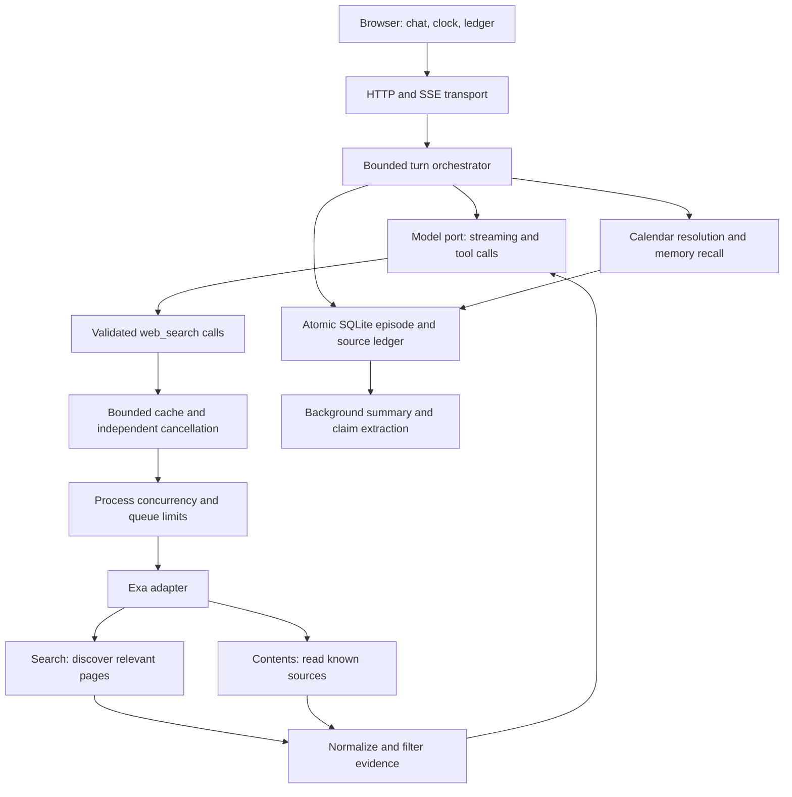

# asof backend architecture

The [complete application architecture and diagrams](architecture/README.md)
extend this initial research. Exa is the project's only web search tool.

Decision date: 12 November 2026. Scope: a self-hosted, single-user research
assistant that can explain what it previously claimed and what changed.

## Recommendation

Keep TypeScript and Node, and build a **modular monolith with ports and adapters**.
Keep SQLite for the current deployment. Make evidence acquisition and temporal
provenance the core domain. Grow deeper research behind the existing search port.
This is an architectural judgment based on the codebase and sources below, not a
claim that one architecture wins every research benchmark.

The product advantage to pursue is **auditable change detection**: every material
claim has a dated source passage, and a recheck can explain then versus now.
Search breadth alone does not deliver that.

Dependency rule: the turn depends on `SearchProvider` and `Llm`, not Exa HTTP
payloads or a model vendor SDK. The composition root in `server.ts` constructs
adapters. Date resolution stays deterministic. The browser consumes the existing
SSE contract. `src/search.ts` remains the import boundary for existing callers.

## What informed the decision

These are representative implementations and primary research, selected for
relevant mechanisms. They are not an independently measured ranking.

| Reference | Relevant mechanism | Decision for asof |
| --- | --- | --- |
| [GPT Researcher](https://github.com/assafelovic/gpt-researcher) | Research reports with citations and parallel research work | Retain parallel independent lookups; preserve original evidence before extraction. Do not import its full report-generation stack. |
| [Open Deep Research implementation](https://github.com/langchain-ai/open_deep_research/blob/main/src/open_deep_research/deep_researcher.py) | A research brief, supervisor, researchers and compressed findings | Consider an explicit deep-research mode later; short factual questions should retain the current low-overhead loop. |
| [Open Deep Research repository](https://github.com/langchain-ai/open_deep_research) | Repository archived on 21 August 2026 | Use as a design reference, not a new runtime dependency. |
| [Vane, formerly Perplexica](https://github.com/ItzCrazyKns/Vane/blob/master/docs/architecture/README.md) | Separates API routes, orchestration, search and storage | Establish these boundaries inside this backend without moving the app to Next.js. |
| [Stanford STORM](https://github.com/stanford-oval/storm) | Multi-perspective research for cited, long-form reports | Evaluate broader question coverage for report tasks; do not add mandatory report planning to every chat. |
| [FutureSearch Deep Research Bench](https://arxiv.org/abs/2506.06287) | Multi-step tasks and a frozen web environment for repeatable comparisons | Separate fixed-evidence correctness tests from live-web retrieval diagnostics. |

All references above were checked on the decision date. Their published
performance claims do not establish asof's performance.

## Exa integration

Use `/search` with `type: auto` and bounded highlights for discovery, and
`/contents` for URLs already known from the ledger or a prior result. Exa supports
both extraction paths; it recommends search with contents for discovery and
Contents for reading specific URLs. [Search API](https://exa.ai/docs/reference/search),
[Contents API](https://exa.ai/docs/contents/quickstart).

An `auto` baseline keeps control of evidence in this app. Exa's current `lite`
mode cannot perform live freshness fetching, so it cannot replace the baseline
for verification. Exa Deep/Agent and Dynamic Highlights should be compared as
experiments before adoption. Dynamic Highlights is currently a research preview.
[Search types](https://exa.ai/docs/reference/search),
[Highlights](https://exa.ai/docs/search/highlights).

### Three distinct time concepts

| Field | Meaning | What it cannot prove |
| --- | --- | --- |
| `publishedDate` | Page's stated publication date, when available | When an evergreen page changed |
| `retrievedAt` | Real wall time when this backend acquired the passage | A page's publication or capture date |
| `snapshotAsOf` | Exact requested upper bound for historical retrieval | The exact timestamp when Exa captured that version |
| Episode `askedAt` | Conversation time from the injectable clock | When a network retrieval actually occurred |

Standard retrieval permits Exa cached content up to 24 hours old; failed refreshes
may still return older cached content. Verification requests use `fresh`, bypass
the local completed-result cache and send `maxAgeHours: 0`. Exa documents that as
content fetched within the last 60 seconds. Avoid labeling ordinary cached
results as live-verified. [Freshness contract](https://exa.ai/docs/contents/quickstart).

For simulated clocks, send `snapshotAsOf` and no live freshness option. Missing
historical evidence remains missing; there is no live fallback. Snapshot access,
coverage and limits depend on the Exa account. The cutoff is not an archive
capture timestamp. [Snapshot semantics and access](https://exa.ai/products/snapshot).

### Retrieval invariants implemented

- Validate query, calendar dates, public URLs, bare domain filters and array sizes
  before contacting Exa. Invalid tool JSON becomes a tool error the model can fix.
- Use only the fixed Exa API host for HTTP. This process never directly crawls
  arbitrary model-supplied URLs. URL validation is lexical, not DNS verification.
- Retry transient network/429/5xx failures once, within a shared 20-second deadline.
  Honor short Retry-After values; return long ones as failures. Do not retry auth,
  payment or invalid-request errors. Provider response bodies are not echoed.
- Recheck domains and publication filters locally, drop invalid URLs and empty
  passages, reject notices that retrieval restrictions were ignored or relaxed.
  Filter explicit per-URL content failures; do not treat URLs alone as evidence.
- Cap returned evidence at 5 results and 2,500 characters per passage, even if the
  provider disregards its requested size. Bound response bodies at 2 MB.
- Remove known tracking parameters and fragments; retain functional URL parameters.
  Give different passages at the same URL separate citation observations.
- Treat source titles and passages as untrusted data. This is a defense layer,
  not a guarantee against all prompt-injection attacks.

## Reliability budgets implemented

| Control | Default |
| --- | --- |
| Search rounds per turn | 3, then force an answer |
| Valid lookup attempts per turn | 12, including failures |
| Parallel searches per turn | 4 |
| Active Exa operations per server process | 4 |
| Queued Exa operations | 64, then return busy |
| Attempts per Exa operation | At most 2 |
| Deadline per Exa operation | 20 seconds, includes retries/body read |
| Deadline for the whole turn | 120 seconds |
| Background enrichment deadline | 30 seconds |
| Completed search cache | LRU, 256 entries, 5 minutes from completion |

These are bounded defaults, not measured latency SLOs or dollar budgets. A model
round can request many tool calls, but only the first 12 valid lookups execute.
Provider retries can produce up to 24 HTTP attempts per turn. Direct Contents
calls can include up to 5 URLs, so logical lookup count is not billable page count.

Cache identity includes exact snapshot instants, domain/URL sets, publication
filter, query and freshness. Failed and empty results are not cached. Callers get
independent copies. Concurrent identical requests share acquisition; cancelling
one subscriber does not cancel another, and cancelling all aborts acquisition.

The cache wraps the process limiter so coalesced callers consume one provider
slot. The turn has a separate limiter so injected/test providers also obey the
per-turn bound. All limits are local to this process, not distributed limits.

## Evidence and memory

`saveEpisode` atomically writes the answer, cited sources and FTS entry. Each
source can now retain its passage, SHA-256, provider/request ID, retrieval method,
retrieval time and historical cutoff. SQLite uses WAL, foreign keys and a busy
timeout. The additive `evidence_json` migration preserves older ledgers, whose
passages remain unknown. A content hash identifies a passage; it does not certify
its truth.

`GET /api/episodes/:id` exposes an episode with its sources and claims for evidence
inspection; `/api/memory` remains a lighter listing. Existing source events can
carry the additional optional fields without changing the UI's citation contract.

Unknown numbered citations fail the turn before persistence. This is referential
validation only: a valid citation number can still support an incorrect claim.
Claims remain model-extracted; entailment, currency normalization and contradiction
resolution require the next evaluation milestone.

Background enrichment is still in-process and can be lost if the process exits.
The raw exchange and cited passages are durable first. No scheduled recheck
worker or durable job queue has been added in this milestone.

## Research and development roadmap

The following work is planned, not shipped.

### 1. Establish quality before increasing autonomy

Build at least 100 versioned tasks: pricing changes, unchanged plans, version
updates, conflicting sources, multi-hop questions, missing evidence and historical
cutoffs. Keep a held-out subset and preserve licensed evidence fixtures with
human labels. Record exact model/configuration versions and repeated runs.

Measure claim correctness, citation precision/recall and entailment, primary-source
coverage, stale-evidence rate, appropriate abstention, p50/p95 latency and actual
provider/model cost. Use blinded human comparison for final answers. A judge
model can assist scoring but should be calibrated against those labels.

The new `npm run eval:search` is a six-task live diagnostic seed, not this full
benchmark. It saves passages and retrieval metrics to JSON. Lexical term coverage
is explicitly not a factual-quality score; snapshot-policy presence does not
verify the provider's historical capture date. API spend is not yet collected.
The existing `npm run eval` still evaluates end-to-end dated recall behavior.

### 2. Compare bounded strategies

Run the same held-out tasks with the same synthesis model and budget:

| Experiment | Baseline | Candidate | Adoption criterion |
| --- | --- | --- | --- |
| Decomposition | Existing model-led lookups | Structured subquestions with coverage checklist | Better completeness without losing factual precision |
| Evidence selection | Exa order and bounded highlights | Larger candidate pool, passage reranking, source diversity | Better supported-claim recall within the latency target |
| Context allocation | Fixed per-page cap | Dynamic Highlights | Better evidence coverage per input token |
| Deep research | Current 3-round loop | Exa Deep/Agent or bounded supervisor flow | Better multi-hop answers at a declared cost/latency budget |
| Verification | Valid citation numbers | Claim-to-passage entailment and targeted rereads | Fewer unsupported claims with calibrated abstention |

Do not average results across incompatible task categories. Report confidence
intervals, failures and cost alongside quality. Keep Exa as the sole web search
tool; compare other engines only through private evaluation recordings.

### 3. Make change detection durable

Add a SQL job table with lease, attempt count, idempotency key and next-run time.
Persist enrichment jobs in the same transaction as the episode. Introduce a
worker with bounded retries, then a volatility policy for claim rechecks.
Store normalized values/units and source observations separately from verdicts.
The ledger now supports a first-class `unverified` verdict rather than forcing
changed/unchanged when a recheck has no valid source.
Keep repeated observations and link each new claim to both old and new evidence.

### 4. Scale when the deployment requires it

For multiple users, authenticate before all chat, memory and clock operations;
add owner IDs and enforce authorization throughout recall and storage. The
current localhost service is explicitly single-user. Session IDs are not access
control. Do not expose this deployment unchanged as a public multi-user service.

Move to PostgreSQL when multiple app instances need shared write storage or
operational requirements exceed the single-file deployment. Keep evidence and
claim tables relational. Add object storage when retaining full pages/documents;
introduce a shared cache/rate limiter only with multiple instances. Extract workers
when durable jobs need separate capacity. Add embeddings only after measuring
lexical recall misses. None of these requires a framework rewrite first.
