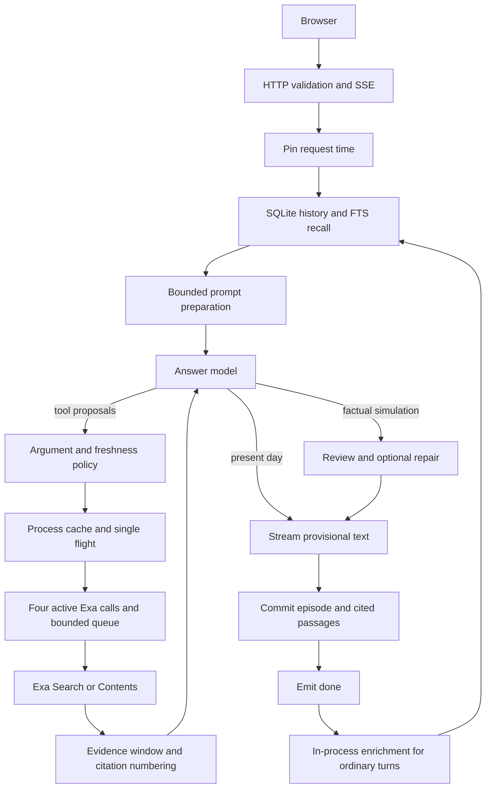
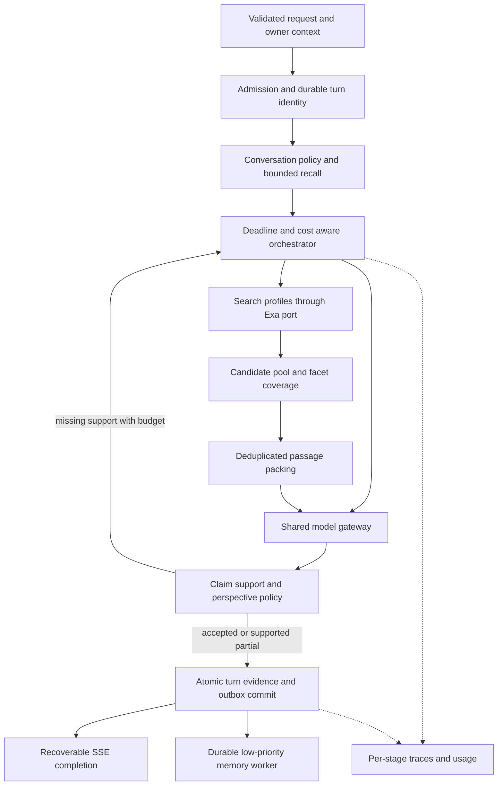

# Backend and web search architecture review — 15 November 2026

> Historical review of the pre-fix implementation. Current repairs and validation are tracked in the [implementation record](backend-search-implementation.md); the reproduced behavior below is not a description of the repaired code.

## Decision

**Keep the modular monolith and repair its execution and evidence contracts before adding search complexity.** The project has a credible prototype foundation. It is not yet a dependable shared service, and the available measurements do not establish competitive search quality. Its main weaknesses are unenforced grounding, incomplete failure handling, unbounded model admission, and an evaluation system that cannot yet distinguish retrieval failures from synthesis failures.

The highest-value next investment is a trustworthy, measurable answer pipeline. Replacing Exa, adding a vector database, or distributing the agent across services would leave the confirmed defects intact. Search quality is an end-to-end property: finding a relevant page is insufficient if its decisive passage is omitted, its date is misinterpreted, or the model ignores it.

The companion [implementation action plan](backend-search-action-plan.md) gives dependency order, estimated effort, acceptance criteria, and release gates. This review assesses the active application; it does not claim the proposed architecture is implemented.

## Scope and evidence

Reviewed the **current working tree**, including its pre-existing modified and untracked files, on branch `harsha-cpp/xr-web-search-architecture`. HEAD was `75c136a0342a267b59de608c937d8e75a4e1739f`; HEAD alone does not identify the reviewed implementation. The [probe report](../../.context/backend-review-2026-11-15/results.json) includes SHA-256 hashes of source, UI, evaluation, test, and dependency files. Runtime: Node v22.16.0.

Coverage: HTTP/SSE boundary; time and session semantics; prompt preparation; model adapters; Exa Search/Contents; caching, concurrency, deadlines and retries; evidence selection and citation validation; simulation review; SQLite/FTS; enrichment; evaluation methodology; deployment and maintenance gaps. Legacy archive/corpus utilities were examined where they overlap the active contract. The separate `.context/ui-preview` application was not revalidated; this report addresses root `src/` and `public/`.

| Evidence collected during this review | Result and limit |
| --- | --- |
| `npm test` | **236 passed**, no failures; network-free behavioral tests |
| `npm run typecheck` | Passed |
| Isolated diagnostic probes | **11 observation groups**, all assertions confirmed current behavior |
| Recall scale probe | 100, 1,000, 10,000 and 33,000 matching episodes; five local calls per size |
| Primary-source research | Exa contract, phased ranking, overload/tail latency, citation evaluation, reproducible search evaluation, SQLite limits |
| Existing live benchmark | Inspected prior report; not rerun or relabeled as new evidence |

The diagnostic [script](../../.context/backend-review-2026-11-15/probes.ts) uses in-memory SQLite and injected model/HTTP responses. Its assertions describe defects, so a future fix should invert the relevant assertion in the normal test suite. Run it from the repository root with `./node_modules/.bin/tsx --disable-warning=ExperimentalWarning .context/backend-review-2026-11-15/probes.ts`. [Results](../../.context/backend-review-2026-11-15/results.json) and [test log](../../.context/review-tests-2026-11-15.log) are workspace artifacts; the substantive observations are preserved below.

No live provider benchmark, production load test, customer database inspection, independent human relevance labeling, or competitor evaluation was performed. Mock reproductions establish reachable software behavior, not its frequency in live model responses. This work adds review documents and isolated diagnostics; it does not modify application behavior.

## Actual architecture

Exa owns web discovery and index ranking. This application owns question interpretation, freshness policy, search orchestration, passage admission, synthesis, review, memory and delivery. Historical chat uses live retrospective research with a simulated viewpoint. It is not a reconstruction of the web as it existed at that date. `runTurn` does not pass the viewpoint as an Exa snapshot cutoff.

The composition root is [server.ts](../../src/server.ts):25. `runTurn` adds a per-turn search limiter; the server also wraps Exa in a process-wide limiter and an outer result cache. The ordering of that outer cache is useful: identical concurrent requests can share one upstream slot.

### Strengths to preserve

- Injectable `Llm` and `SearchProvider` ports make orchestration testable without external services.
- Time is pinned once per turn, and real acquisition time is separate from the simulated perspective.
- Search has bounded HTTP response size, cancellation, transient retry, policy validation, URL normalization, and nonempty passage requirements.
- The cache has TTL/LRU bounds, cloned results, and subscriber-aware cancellation. Fresh requests bypass completed results while retaining in-flight sharing.
- Evidence has a shared serialization-aware character budget; saved cited text is the admitted passage, with a content hash.
- SQLite writes episodes and cited sources atomically. SQL parameters, foreign keys and WAL are already present.
- The Responses adapter validates completion and preserves tool/reasoning items. Citation parsing is shared with the rendered browser representation.

These are meaningful engineering assets. The findings below concern missing guarantees around them.

### Current resource envelope

| Resource | Implemented limit | Consequence |
| --- | --- | --- |
| HTTP body / user message | 100,000 bytes / 8,000 JS string characters | Message bound is not a complete token budget |
| Recent history / recall text | 8 turns, 18,000 chars / 12,000 chars | Recall SQL materialization happens before clipping |
| Evidence | 32,000 chars over all rounds | Earlier and repeated passages can consume later capacity |
| Exa output | 5 hits × up to 2,500 chars per lookup | Direct reads also return only short highlights |
| Generic evidence passage | 6,000 chars | Active Exa adapter's 2,500-char cap is tighter |
| Search | 3 rounds, 12 valid attempts; 4 active per turn and process | Call count does not measure useful information gained |
| Exa queue / HTTP | 64 queued process lookups / 20 seconds after starting adapter | Queue wait is outside the adapter deadline |
| HTTP attempts | At most 2 per lookup | 12 logical lookups can create up to 24 Exa attempts |
| Turn | 120 seconds, cooperative abort | Synchronous database work is not interrupted by the timer |
| Review and repair | Review 10s, repair 15s, second review 10s | Up to 35s of additional sequential allowance, inside turn budget |
| Foreground model work | Up to 4 generation calls, plus review/repair | No global model admission or explicit output-token cap |
| Enrichment | 2 active; 128 total pending jobs | Memory only; overload drops work |

## Findings and recommended changes

P1 means a correctness/reliability issue to address before claiming dependable behavior in the affected mode. P2 means the next reliability or quality iteration. P3 is contained maintenance. Shared-hosting severity is explicitly conditional; the current server binds to loopback.

### F01 · P1 · Current-fact verification can succeed without evidence

**Code:** [run.ts](../../src/agent/run.ts):123,157,194; [prepare.ts](../../src/agent/prepare.ts):16.

`fresh` changes a search request only after the model proposes one. Tool choice remains `auto`, and an answer with zero citations passes `cited.some(...)`. Ordinary present-day answers receive no semantic review. The prompt asks for grounding, but the application does not enforce it.

**Reproduced:** “Verify the current Acme plan price today” had intent `verify` and `fresh: true`, yet a scripted $999/month answer completed, was saved, and had zero searches and zero sources.

**Change:** establish an evidence requirement for explicit verification and volatile factual answers. Require a successful applicable lookup or a clearly qualified unresolved result. Track support per material claim; one search or one citation alone cannot satisfy this contract. Preserve the direct path for conversation and supplied-text transformations. When search fails, retain supported partial answers and identify the unresolved fact. Do not instruct every failed present-day lookup to fall back to “well-established history.”

**Acceptance:** no-search, empty-search, failed-search, irrelevant-source and contradictory-source fixtures cannot complete an unqualified verification claim; supported partial answers remain possible.

### F02 · P1 · A bad correction erases a valid negative review

**Code:** [simulation.ts](../../src/agent/simulation.ts):141–163; [run.ts](../../src/agent/run.ts):214–243.

A valid `needs_revision` verdict with a malformed `safeAnswer` becomes `unavailable` with no retained issues. The turn then publishes the original draft. Separately, a nonempty correction with **no citations** passes the `every()` check for valid citation numbers; this is reference validation, not source-support validation.

**Reproduced:** a 1940 draft disclosed India's 1947 independence date. The reviewer detected leakage, but its correction cited `[99]`. The rejected draft was emitted and saved with review `unavailable`. A separate probe accepted an uncited factual replacement as `safeAnswer`.

**Change:** parse verdict, issues and proposed repair independently. A known rejection survives invalid repairs, timeouts and subsequent outages. Use explicit outcome states: approved, supported partial, unreviewed, needs revision, interrupted. A correction must satisfy the same grounding/perspective policy as a normal draft. An uncertainty-only correction need not invent citations.

**Acceptance:** invalid/missing repair, reviewer outage, second-review rejection and oversized review inputs cannot silently convert rejected factual prose into accepted output. Preserve the finding trail without exposing private model reasoning.

### F03 · P1 at larger histories · Recall has unbounded work and a hard query failure

**Code:** [store.ts](../../src/memory/store.ts):303,331–345; [recall.ts](../../src/memory/recall.ts):83,130–139.

`termCoverage` materializes all matching FTS row IDs for up to 12 terms. `episodesById` creates one SQL parameter per matching ID before selecting the final three related records in JavaScript. Date retrieval also has no row limit. A small final prompt therefore does not imply bounded database work.

**Reproduced:** with 33,000 matching episodes, recall throws `too many SQL variables`. This occurs before a model call. The runtime's limit is consistent with SQLite's documented default of 32,766 host parameters in modern versions; the cutoff argument uses a parameter too. [SQLite limits](https://www.sqlite.org/limits.html).

| Matching episodes | Median of 5 local recall calls | Outcome |
| --- | ---: | --- |
| 100 | 0.23 ms | Success |
| 1,000 | 1.43 ms | Success |
| 10,000 | 12.09 ms | Success |
| 33,000 | 15.24 ms to failure | All five fail |

These are warm, in-memory, synthetic measurements with short records, not production latency estimates. The failure establishes a design limit; the timings do not establish capacity.

**Change:** push visibility predicates, candidate limits and ranking into SQL; use a bounded candidate relation rather than an unbounded `IN` list. Preserve distinct-term coverage behavior or evaluate a replacement ranking explicitly. Date recall should return bounded relevant records plus counts/pagination. Apply owner and viewpoint constraints before admitting candidates. Profile realistic answer lengths and disk-backed data; batching an unbounded scan only avoids the SQL limit, not the scaling problem.

**Acceptance:** 100,000-record fixtures, broad terms, many future records and dense date ranges stay bounded, preserve cutoff semantics, and return deterministic top results.

### F04 · P1 for the default adapter · Truncated model streams are accepted as finished

**Code:** [llm.ts](../../src/llm.ts):63–109; contrast [responses.ts](../../src/llm/responses.ts):45–72.

Chat Completions concatenates deltas and returns at stream EOF without requiring a successful terminal reason. It ignores `finish_reason: length` and does not request/report streaming usage. The Responses path has stronger completion checks. Chat Completions remains the default configuration.

**Reproduced:** both clean EOF without a terminal completion and a `length` termination returned “An unfinished answer because” as a normal response. The current default-adapter test also accepts a terminal-less stream.

**Change:** give both adapters a common completion contract, appropriate token ceilings, incremental text/tool-argument size limits, validated tool IDs and usage reporting. Distinguish interrupted, truncated, filtered, refused and completed responses. Model/provider limits should be capability-aware.

**Acceptance:** truncation cannot be saved as a complete answer; both modes pass the same semantic adapter tests. Usage on errors is captured when the provider supplies it.

### F05 · P1 before increasing traffic · Search admission does not bound model load

**Code:** [server.ts](../../src/server.ts):25–29,82–112; [run.ts](../../src/agent/run.ts):157,207; [enrich.ts](../../src/memory/enrich.ts):107.

Every incoming turn may immediately call the model. Foreground generation, review and enrichment share account resources without a shared request/token budget or foreground priority. A turn timeout limits duration, not concurrency or spend. No explicit output-token ceiling bounds an individual generation, and the loop's character caps exclude model preambles, tool argument strings and opaque reasoning output.

**Reproduced:** 20 simultaneous no-search turns entered 20 model calls despite the search limiter. This is an admission test using a gated mock, not evidence of upstream throughput.

**Change:** admit work before opening SSE; cap active turns, model requests and queued work with per-account fairness and remaining-deadline checks. Reserve capacity for foreground work, enforce provider request/token quotas, and impose per-turn token/cost limits. Enrichment uses residual capacity. Return consistent busy/retry responses and retain cancellation while queued.

**Acceptance:** burst and sustained-load tests never exceed configured active/queued limits; busy requests do not call providers; review and final synthesis have reserved capacity. Bounded queues and explicit overload behavior follow established serving practice. [Google SRE overload handling](https://sre.google/sre-book/handling-overload/).

### F06 · P1 · Visible output is not recoverably committed

**Code:** [run.ts](../../src/agent/run.ts):162,240–255; [server.ts](../../src/server.ts):96–111; [app.js](../../public/app.js):474–523.

Both ordinary and buffered simulation text are emitted before `saveEpisode`. `done` follows the commit, but there is no preallocated turn ID, idempotency key or recovery endpoint. Root UI treats clean stream EOF as normal even without `done`. SSE writes ignore backpressure and have no heartbeat or resumable event identity.

**Reproduced:** an injected save failure produced `text` followed by `error`, with zero episodes saved. Normal UI replaces text on an explicit error, but publication already occurred. A commit followed by a lost completion event creates the complementary retry/duplication risk.

**Change:** create a durable turn identity before generation. Mark live deltas provisional until commit; commit buffered answers before releasing them. A turn-status endpoint recovers committed results after disconnect. Require `done` for client success; honor write backpressure or cancel persistently slow readers. Use heartbeat and proxy configuration appropriate to deployment.

**Acceptance:** disk failure, disconnect before/after commit, duplicate POST and EOF-without-done tests produce one consistent durable result and an accurate UI state.

### F07 · P1 before shared hosting · Identity and viewpoint are process-global concerns

**Code:** [server.ts](../../src/server.ts):19,123–147; [clock.ts](../../src/clock.ts):21; [store.ts](../../src/memory/store.ts):87–99,319.

Session IDs are conversation identifiers. Ledger/detail routes and cross-conversation recall have no owner isolation. The mutable clock affects every unpinned request and global ledger visibility. History is ordered by simulated `asked_at`, so moving backward in time can reverse real conversation order. Same-session concurrent requests can also branch from the same history with no sequence conflict detection.

**Reproduced:** a second clock selection changes a subsequent unpinned turn; an episode created second with an older viewpoint appears first in history. Pinning correctly protects a turn already in progress.

**Change:** persist conversation viewpoint; send explicit mode and viewpoint per request. Separate `created_at`, `viewpoint_at` and conversation sequence. Define how changing viewpoint creates a branch or affects eligible memory. Before shared hosting, authenticate owners and scope every query and route, including FTS and caches of personalized content. Serialize same-conversation writes or use optimistic sequence checks. Add Origin/Host validation appropriate to local and hosted deployments.

This is a conditional exposure risk, not a claim that the current loopback service is publicly accessible.

### F08 · P2 · Evidence admission rewards arrival order and repetition

**Code:** [evidence.ts](../../src/agent/evidence.ts):17–62; [run.ts](../../src/agent/run.ts):111–119,184–189.

Citation identity deduplicates URL plus admitted text hash, but the same text is serialized and charged repeatedly. Results are admitted in requested-call order, preserving determinism while privileging earlier calls. There is no per-question-facet allocation or reserved budget for later corrections. Truncating a repeated passage can even give the same source a new passage identity.

**Reproduced:** three renderings of five 2,500-character passages consumed almost all the 32,000-character window. A fourth lookup's new fact was omitted. The report records 31,926 characters and 13 passage admissions from repeated inputs.

**Change:** deduplicate exact observations before budget charging, reference already admitted evidence compactly, then select passages across all results in a round. Allocate space to uncovered question facets, preserve complementary passages from the same URL, and reserve a configurable fraction for follow-up evidence. Maintain stable citation IDs independent of packing/truncation decisions.

**Acceptance:** duplicates do not spend another full passage budget; a late decisive fact remains admissible; multi-part questions receive coverage without exceeding the aggregate bound.

### F09 · P2 · Retrieval has one fixed depth for very different tasks

**Code:** [exa.ts](../../src/search/exa.ts):6,35–42,94–104; [types.ts](../../src/search/types.ts):1.

Every query uses `auto`, five results, and 2,500-character highlights. A direct URL read uses the same excerpt limit. There is no explicit facet coverage, primary-source preference, locale, long-table extraction mode, contradiction-driven escalation, or retrieval-quality metadata in the port. The model may compensate with repeated searches, increasing latency without assurance of additional coverage.

**Change:** keep the existing fast default and add measured profiles: direct source lookup, ordinary fact lookup, explicit verification, comparison/multi-part research, and historical perspective. Escalate only for missing facets, conflicting evidence or insufficient passages. For a long list/table, allow a bounded full-text Contents read of selected URLs and extract exact supporting spans. Preserve Exa rank initially; test query-aware passage selection or bounded reranking before enabling it.

Current Exa documentation distinguishes `auto`, lower-latency `lite`, and deeper modes. `lite` does not accept live-fetch freshness controls; switching the current request's `type` alone would be incorrect because this adapter always sends `maxAgeHours`. Treat mode support as a capability contract, not a string toggle. [Exa Search reference](https://exa.ai/docs/reference/search).

### F10 · P2 · Freshness is a request policy, not verified source age

**Code:** [exa.ts](../../src/search/exa.ts):32–37,78–102; [cache.ts](../../src/search/cache.ts):5–34.

The local TTL is five minutes; standard upstream requests ask for content no older than 24 hours. `retrievedAt` records when the application received the response, not when the page was fetched or updated. Provider cache/crawl status and cost are discarded. Keyword freshness hints cannot reliably resolve pronouns, multilingual phrasing or implicit volatile facts from conversation context.

Exa documents positive-age requests that can fall back to cached content when fetching fails, and `maxAgeHours: 0` as content fetched within the last 60 seconds. A fresh call is therefore not proof of a newly fetched page at this exact instant. [Exa Contents reference](https://exa.ai/docs/reference/get-contents).

**Change:** retain requested policy, provider acquisition status and any reported content timestamp separately; use `unknown` when age cannot be established. Define task-level acceptable staleness and disclose consequential uncertainty. Cache keys must include every new retrieval control, language/locale and policy version; do not cache personalized final answers without owner/history identity.

### F11 · P2 · Memory loses searchable answer content and background work

**Code:** [store.ts](../../src/memory/store.ts):258–290; [enrich.ts](../../src/memory/enrich.ts):43–57,107–125; [run.ts](../../src/agent/run.ts):265.

Initial FTS contains question text and optional legacy verified statements, not the answer. Factual simulations skip enrichment. Ordinary enrichment can be dropped on overflow, fail, or disappear on process exit. A stored answer can therefore exist without being discoverable through terms introduced in that answer.

**Reproduced:** “Barack Obama” exists in an answer but yields zero FTS matches. It is safe to index a conversational statement without representing it as verified truth.

**Change:** synchronously index a bounded answer representation tagged as untrusted conversation; distinguish retrieval from truth status. Add an outbox row in the episode transaction, with leases/retries and idempotent completion. Preserve stable claim IDs: current enrichment deletes and recreates claims, which conflicts with later `prior_claim_id` references during replay. Bound extracted field lengths as well as counts.

**Acceptance:** restart/overflow cannot silently lose required enrichment; retries cannot break claim references; answer-only topic recall works for simulations and failed enrichment.

### F12 · P2 · Observability and evaluation do not support quality or speed claims

**Code:** [server.ts](../../src/server.ts):25; [run.ts](../../src/agent/run.ts):248–259; [benchmark.ts](../../eval/benchmark.ts):73; [score.ts](../../eval/benchmark/score.ts):34–81; [simulation.ts](../../eval/simulation.ts):123–127,181.

Production does not wire model usage callbacks. Search returns hits without cache/queue/attempt/cost metadata. Failure traces are not durably recorded; aggregate timings are mainly emitted to SSE. Model-stage latency, queue delay and useful-evidence coverage cannot be separated. Server `firstTokenMs` measures emission time, not confirmed client rendering.

The retrieval diagnostic uses six lexical/source-policy cases. The generic benchmark computes nDCG/MRR from **saved cited sources**, in admission order, after uncited retrieval results have been discarded. That can describe cited-source selection, but it is not Exa retrieval ranking quality. Exact phrase matches do not establish correct claims, and a numeric citation check is vacuously true for no citations.

The prior simulation report has 16 developer-authored scenarios, one sample each, plus three present-day baselines. Answering, review and semantic judging use the same configured main model in separate requests. Correlated error is possible. The report accurately disclaims universal accuracy, but these measurements cannot support a superiority claim.

**Change:** retain bounded per-stage traces and separate retrieved, admitted and cited evidence. Evaluate retrieval relevance, answer correctness, claim support, completeness, freshness, abstention, latency and cost independently. Use human-adjudicated held-out cases to calibrate model judgments. Citation correctness and answer correctness are separate evaluation dimensions. [ALCE research](https://arxiv.org/abs/2305.14627).

### F13 · P2 · Deployment readiness is undocumented and untested

**Code:** [server.ts](../../src/server.ts):155–168; [store.ts](../../src/memory/store.ts):209–218. No `.github` workflow directory was present.

No application-level graceful shutdown, readiness endpoint, migration version ledger, backup/restore procedure, retention policy, durable worker recovery or automated release gate was found. Synchronous SQLite work shares the SSE event loop; the five-second busy timeout can stall unrelated requests if another connection holds a conflicting lock. Ledger listing performs per-episode queries and is capped at 100 rather than paginated.

**Change:** add tested backup/restore, migration checks, bounded shutdown/drain, health/readiness, dependency/runtime update policy and CI. Batch/paginate ledger reads and measure event-loop delay. Keep SQLite on one host while that matches the workload; WAL allows concurrent readers but still only one writer and does not work as a shared network filesystem database. [SQLite WAL](https://www.sqlite.org/wal.html).

Move to PostgreSQL when multiple application hosts, recovery requirements or measured write contention justify it. Auth and query ownership are required independently of database choice. There is no evidence here that a database migration alone will materially reduce model-dominated latency.

### F14 · P3 · Legacy contracts and older plans can mislead new work

**Code:** [exa.ts](../../src/search/exa.ts):89–93; [types.ts](../../src/search/types.ts):7; [evidence.ts](../../src/agent/evidence.ts):3; [search-quality.ts](../../eval/search-quality.ts):19.

The provider sends `publishedBefore` but does not locally reject later-dated responses unless `asOf` is also set. **Reproduced:** a request capped at 2020 admitted a mocked 2026 result. This parameter is not currently exposed by active chat, so its immediate impact is provider/legacy utility contract correctness.

Legacy snapshot types, eligibility imports, archive tests and older “completed” plans coexist with live era simulation. This inflates apparent active-path coverage and makes retired behavior easy to reconnect accidentally.

**Change:** separate live-research and legacy temporal contracts, enforce all advertised provider filters, and mark old plans with their historical scope. Keep one authoritative capability matrix and classify tests by active chat, provider, legacy research and evaluation.

## Latency and workload diagnosis

A useful first-order model is:

`turn latency = admission + recall + sum(model stages) + sum(search-round barriers) + review/repair + commit + delivery`

Each search round uses `Promise.all`; the next model stage waits for its slowest lookup, including queue time. Search requests are parallel, but model/search rounds and simulation review are sequential. More queries can improve coverage and worsen tail latency simultaneously. This is why optimizing median provider response alone is insufficient. [The Tail at Scale](https://research.google/pubs/the-tail-at-scale/).

At four Exa slots, approximate search service capacity is `4 / mean occupied-slot seconds` lookups per second, before headroom and provider quota. With an illustrative two-second service time and three uncached lookups per turn, that is about 0.67 search-bearing turns/second. These are assumptions, not measurements. A queue of 64 lookups can require 16 service waves; at the 20-second ceiling that is roughly 320 seconds before a late request starts, exceeding the whole-turn deadline. Cancellation eventually removes it, but it has already waited unproductively.

The existing report records simulation p50 **13.795s**, p95 **28.252s**, and median paired overhead **3.024s** on three paired cases. First-word median equals the simulation completion median because factual drafts are buffered for review. These are prior single-sample development observations; the p95 of 16 scenarios is the maximum sample, not a stable tail estimate. See [prior report summary](../../.context/simulation-benchmark-summary.json).

Optimize in this order: measure stage/queue time; enforce admission and deadline reserve; remove duplicate evidence and redundant queries; reduce unnecessary serial rounds; selectively deepen retrieval; then evaluate model/reasoning choices. Static asset caching and micro-optimizing small helpers cannot plausibly explain away a many-second model/search path without contrary profiling evidence.

## Target architecture

These are modules in one service initially. Give them explicit records: `TurnContext` (identity, viewpoint, received time, deadline); `TurnBudget` (remaining tokens, cost, searches and review reserve); `RetrievalBatch` (ranked hits plus attempts, queue and freshness metadata); `EvidenceSet` (exact observations, facets and claim links); `TurnOutcome` (completion and quality states); and `MemoryJob` (version, lease and attempts). Extend existing ports incrementally rather than replacing the application in one rewrite.

An adaptive strategy should stop when supported coverage is sufficient, not merely when a fixed number of calls has elapsed. It should deepen for missing evidence and return a useful partial result at its budget boundary. Expensive ranking should operate on a bounded candidate set, with measured gains; phased-ranking systems exemplify this principle. This does not imply installing Vespa for this application. [Vespa phased ranking](https://docs.vespa.ai/en/ranking/phased-ranking.html).

Keep frozen evidence replays for isolating software/model changes, and separate live runs for current web behavior. This distinction is supported by research using a frozen search environment to control changes in the web. The application can continue using live research while the evaluation harness uses fixed evidence. [Deep Research Bench](https://arxiv.org/abs/2506.06287).

## What would justify a stronger architecture claim

A passing test suite establishes the behaviors it tests. A credible quality claim additionally needs a declared workload, held-out labels, representative failures, repeated provider runs, human-calibrated judging, uncertainty intervals and actual cost. A credible speed claim needs p50/p95/p99 by workload class at declared offered load, with cancellations and errors included. A credible production claim needs recovery, isolation and overload drills.

The first release target should be a reliably grounded, recoverable single-user answer engine with measured costs. Shared hosting and broader retrieval experiments follow the explicit gates in the [action plan](backend-search-action-plan.md).
