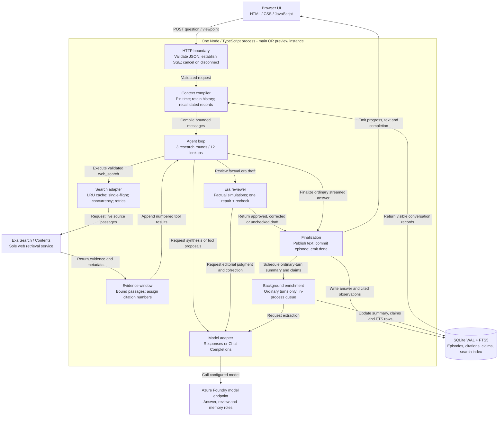

# Agent component diagram  -  current runtime

This is a component/dataflow view, not a statement that every edge executes in strict diagram order. Ordinary text streams while generation runs. Factual simulation text is buffered for review but currently published before the SQLite commit; `done` follows commit. See the [actual sequence](c4-dynamic-answer.md) and findings R1/R5 in the [review](review-2026-11-14.md).

The exact same engine files run in the isolated preview. Preview-only UI source inspection and session restoration do not add a second search service. No archive retrieval or Snapshot gate is in the composed chat path.
