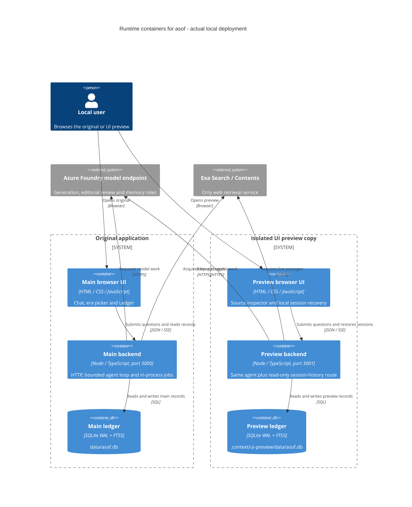

# Runtime containers  -  original and isolated preview

Each application is one backend process and one SQLite file. Prompt preparation, model orchestration, search cache, concurrency limiters and background enrichment are **components inside that process**, not separately deployed services. SQLite is a local data store, not another application server.

The preview has its own source files, copied dependencies, database, clock object and browser-origin storage. Its only server-route addition is `GET /api/sessions/:id` for reopening saved conversations. The original application has not been merged with these UI changes. Cloud account quotas and billing remain shared.

Original composition root: `src/server.ts`. Preview root: `.context/ui-preview/src/server.ts`. The agent and search implementation files are identical between the reviewed copies. The [component diagram](c4-components-agent.md) applies to either backend instance.

The private benchmark is a separate command-line program with isolated in-memory stores and private output files. It has no dashboard route and is not a production dependency.
