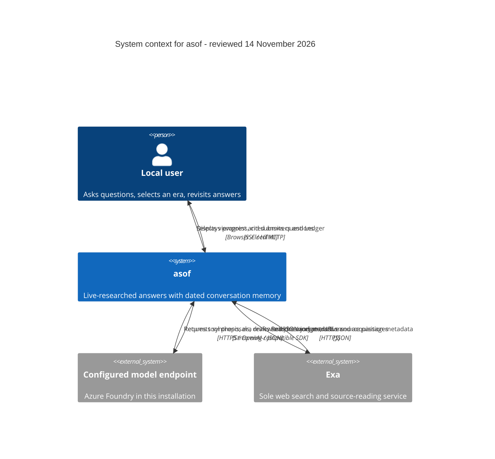

# System context  -  asof

The model proposes `web_search` calls; the server validates and executes them. It has no application-provided direct web browser, shell or second search provider. Exa remains the only search and source-reading service used by chat.

Era simulation researches modern sources and frames the answer by event dates and selected-era knowledge. Model review can request one correction; an unavailable review can currently return an unchecked draft. No Snapshot or archive acquisition service is composed into chat.

The original and UI preview are separate local application instances, described in the [container diagram](c4-containers.md). Both still use the configured cloud accounts. The current user boundary is a local single-user assumption, not implemented authentication; see R6 in the [full review](review-2026-11-14.md).
