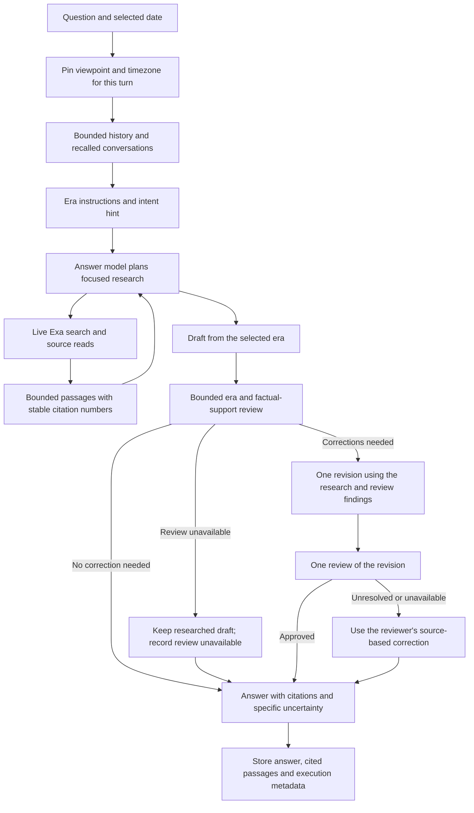

# Era simulation

The selected date is a viewpoint for the answer. Exa researches the live web,
including modern historical accounts, then the model reconstructs what had
happened by that viewpoint. Chat does not require an old web capture, a special
archive entitlement, or a manually loaded document for each question.

Exa remains the only web search provider. The application stays a modular
TypeScript/Node process with SQLite conversation memory.

## Request path



Creative writing and transformations of supplied text do not need factual web
research. Present-day requests retain the ordinary search and streaming path.
The browser receives search and review progress while a simulated factual answer
is prepared. An unavailable reviewer is reported as an incomplete review; it
does not recreate the retired archive-access failure.

## Event time and research time

Three times have separate meanings:

| Time | Meaning |
| --- | --- |
| Selected viewpoint (`effectiveAt`) | The date from which the answer speaks. |
| Event date in the evidence | Whether an event has happened from that viewpoint. |
| Actual retrieval time (`retrievedAt`) | When the application researched the live source. |

A modern article can support a fact about 1947. Its publication in 2026 does not
make the 1947 event unavailable to a simulation set in 1948. Conversely, a source
discussing a later event does not allow the answer to treat that event as already
completed. Publication filters are research controls, not the simulation cutoff.

For example, at a viewpoint in January 1948, “Will India get independence?” should
recognize that independence already occurred on 15 August 1947. At an earlier
viewpoint, the response must distinguish an announced plan from an accomplished
event and avoid giving a future outcome as certain.

The same rule applies to other categories:

- Office holders require evidence about the selected period, rather than the
  modern holder's name copied from a current page.
- Annual winners lists include only seasons completed by the selected date.
- Products and technologies that did not yet exist are not offered as available.
- Historical prices require evidence for the actual period and product; a modern
  price cannot be silently backdated.
- Forecasts and counterfactual scenarios are labeled hypothetical. Later-known
  outcomes do not become guaranteed predictions.

## Grounding and review

The model receives trusted time instructions separately from the user's question,
past conversations and untrusted web passages. Exact clock readings, memory
visibility, source numbering, citation references, request limits and budgets stay
in code. Language interpretation and historical synthesis remain model work.

The simulation reviewer checks temporal framing, conflicts with the supplied
evidence, unsupported assertions and citation use. A correction can remove a
future outcome, fix a mistaken premise, or narrow a claim to what the source
actually establishes. This is a bounded quality check, not an authenticity proof
or a requirement for a matching pre-cutoff capture.

If research is thin, the answer should explain the particular gap and still give
the supported portion. It must not invent an exact price, a nonexistent product,
or a guaranteed future event to fill the gap. Ordinary model/search outages
remain possible and receive service-error handling.

The ledger preserves the cited passage observations and their real retrieval
times. Existing archived citation URLs still resolve to their original preserved
versions. That audit history does not activate archive retrieval for new chat
requests. Obsolete access-error answers from the retired mode are shown as a
request to ask again, without changing stored records.

## Evaluation

```sh
npm test
npm run typecheck
npm run eval:simulation
npm run eval:simulation -- --live --out .context/simulation-benchmark.json
```

The default simulation command is an offline preflight. Live evaluation uses the
configured model and Exa API, with isolated in-memory conversation databases and
no curated source loading. Optional `--case`, `--limit`, `--concurrency 1-3` and
`--no-current-baseline` flags control the run.

The suite spans event boundaries, early history, office holders, complete annual
lists, unavailable technologies, historical prices, hypothetical forecasts,
creative tasks and supplied-text transformations. Matched present-day stable-fact
cases provide a latency and behavior reference. Reports distinguish exact checks
from model-judged criteria and include failures, citations and latency; they remain
private files rather than dashboard features.

These measurements establish behavior on the declared cases. They do not establish
100% accuracy, reproduce a frozen historical internet, or measure superiority to
another search engine. Modern retrospectives and the model's training can contain
later knowledge; the era instructions and review reduce that risk without proving
it impossible. Source errors, missing evidence and ambiguous chronology remain
evaluation concerns.

## Retired archive research utilities

The immutable corpus, capture/export CLI and strict historical-evidence checker
remain available for legacy datasets and their regression tests. They are not
dependencies of chat, the date picker, or the era-simulation benchmark. No import
or access upgrade is needed to use the simulation.
