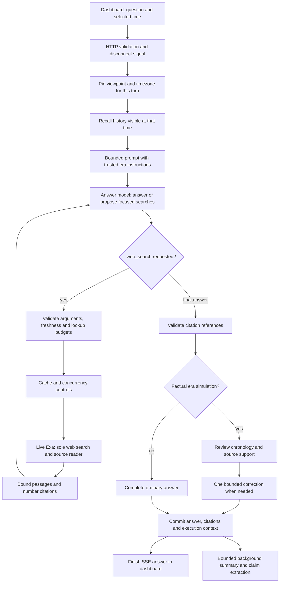

# Complete request and answer flow

| Stage | Implementation | Purpose |
| --- | --- | --- |
| Request | `src/server.ts` | Validate message, session, timezone and optional ISO `asOf`; cancel on disconnect. |
| Time | `src/clock.ts`, `src/time/instant.ts` | Pin viewpoint separately from real receipt time; reject invalid dates. |
| Recall | `src/memory/recall.ts`, `src/memory/store.ts` | Exclude later conversations before prompting. |
| Prompt | `src/agent/prepare.ts`, `src/agent/prompt.ts` | Separate trusted era instructions, prior records and the original question. |
| Research loop | `src/agent/run.ts` | One answer model proposes focused searches without a mandatory planner call. |
| Acquisition | `src/search/` | Live Exa Search/Contents, cache, bounded queue, retries and cancellation. |
| Evidence | `src/agent/evidence.ts` | Bound untrusted source passages and assign stable citation numbers. |
| Simulation review | `src/agent/simulation.ts`, `src/agent/run.ts` | Check event chronology and factual support; request one correction when useful. |
| Persistence | `src/memory/store.ts` | Save answer, exact cited passages, hashes and execution metadata together. |
| Extraction | `src/memory/enrich.ts` | Summarize and link claims off the response path. |

Both present-day and simulated questions use ordinary live Exa research. A source's
publication date does not determine whether its historical event can be used.
No archive acquisition or preserved-page eligibility gate runs in chat.

The browser streams ordinary answers and immediately shows research progress.
Simulated factual drafts are reviewed before display. A tool call retracts an
ordinary provisional preamble. Source numbering follows requested tool-call order,
independent of network completion order.
