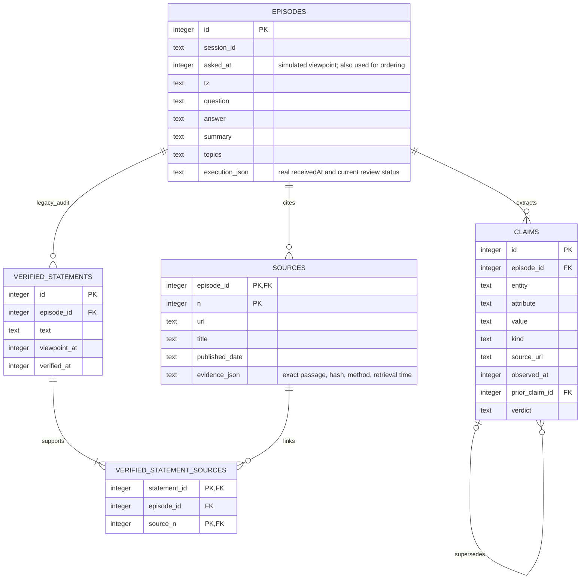

# Stored data model  -  reviewed implementation

`episodes_fts` is a separate FTS5 virtual index with `question`, `summary`, `topics` and `entities`, linked by row ID in application code. It is not a source-of-truth facts table and has no declared episode foreign key. New factual simulation turns currently index their question only, because they bypass enrichment and do not write legacy verified statements.

The verified-statement tables and immutability triggers support the retired strict historical workflow. Current era simulation writes answers/citations/review metadata, not new verified statements. Ordinary extracted claims are model interpretations and can carry an `unverified` verdict.

There is currently no users/owners table, conversations/settings table, durable turns/idempotency table, or outbox table. Recommended additions in the review are explicitly future work. In particular, actual creation order and selected historical viewpoint should become separately indexed fields.
