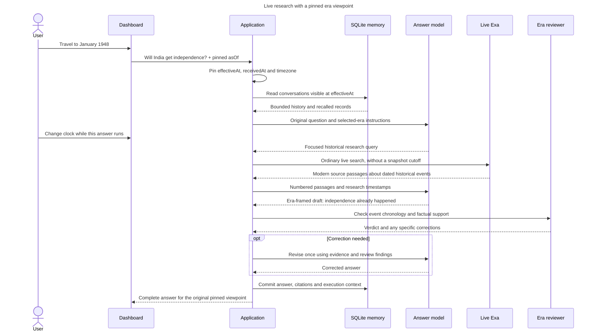

# Era simulation request sequence

The simulated clock keeps ticking between requests. Each request uses one fixed
reading, even if the user travels again while it is running. The same upper bound
applies to chat history, date recall, topic recall, nearby conversation suggestions
and ledger reads. Direct episode reads after the selected clock return 404.

`effectiveAt` is conversation/viewpoint time. `receivedAt` and source `retrievedAt`
are real wall time. The research source may have been published after the
viewpoint; the event being asserted must fit the viewpoint. See the
[era simulation guide](historical-evidence.md) for examples and limits.

Future selected dates are hypothetical scenarios. The model may discuss plausible
possibilities, but cannot present later events, prices or results as established
facts. Modern retrospectives are useful research, not a perfect reproduction of
what an observer could have known at the time.
