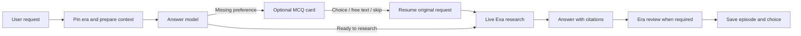

# Optional research clarification

In the isolated UI preview, an underspecified research or recommendation request can pause for one useful question before Exa research. The main answer model uses an `ask_clarification` function with 2–4 neutral choices. Free text and “use your best judgment” are always available; nothing is preselected.

Clear factual questions, greetings, creative writing, supplied-text transformations, pure recall, and explicit requests for no questions bypass the feature. An inexpensive eligibility check narrows the opportunity; the model decides whether missing scope or a preference would materially change its answer. “About half” is guidance for genuinely open-ended tasks, never a random quota or a promised rate. There is no mandatory separate planner call for every message. Asking does consume one model response; answering after a choice is a new request.

The MCQ function controls the UI and never retrieves facts. Exa remains the sole search/source provider. The user’s selection is task-specific context, not web evidence. It enters the search and answer prompt alongside the original question, with instructions to apply it and never ask a second clarification for that request. Prior choices remain attached to the corresponding conversation turn.

Pending questions live in `clarification_questions`, separately from answered episodes. The server saves the original message, session, timezone, temporal mode and era instant; it ignores client attempts to replace those on resume. A live question resumes in live mode; a simulated question keeps its original historical instant even if the clock changes while waiting. No network stream or model call stays open while waiting for a user. Pending questions expire after 24 hours of real time.

Question and selection payloads are bounded and validated. Options receive server IDs; submitted labels are never trusted. A choice is sealed on first submission, concurrent resumes are rejected within the single server process, and interrupted requests can retry the same choice. Completed retries replay the saved episode instead of researching again. Browser refresh restores either the pending choices or the saved selection. An answered episode stores its choice in `execution.clarification` and displays it with the restored conversation.

The feature follows the existing single-process, local-user app model. It does not add authentication or distributed locking. Resume timings describe the resumed research request; the earlier question-generation request and time spent waiting for the user are not included. The feature does not establish an answer-accuracy guarantee or claim a measured uplift.

Validation: `npm test` and `npm run typecheck`, plus `test/clarification.test.ts`, `test/clarification-api.test.ts`, and the clarification cases in `test/clock-ui.test.ts`. The HTTP tests use a local scripted model, and check plumbing rather than model decision quality. Small live checks and desktop/mobile screenshots are kept privately under the workspace `.context/`.
